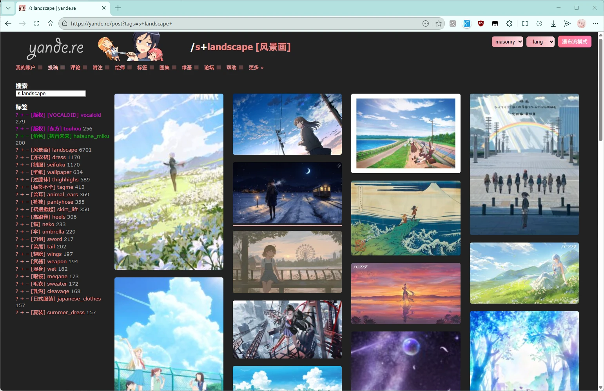
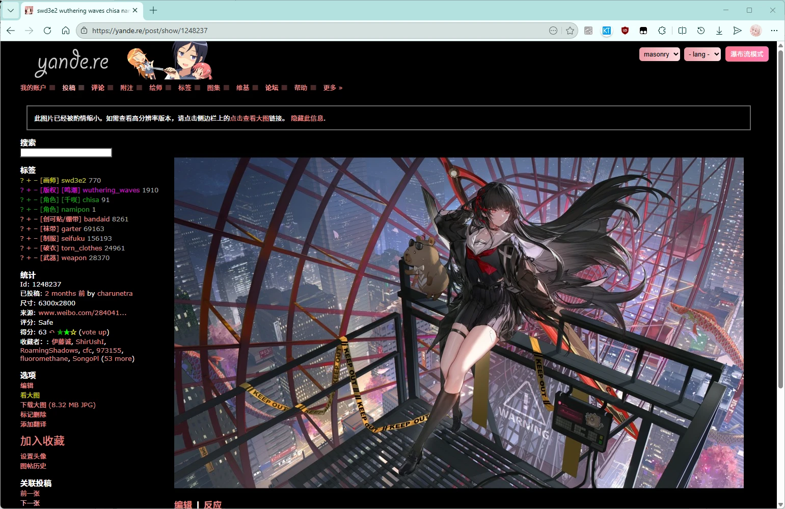
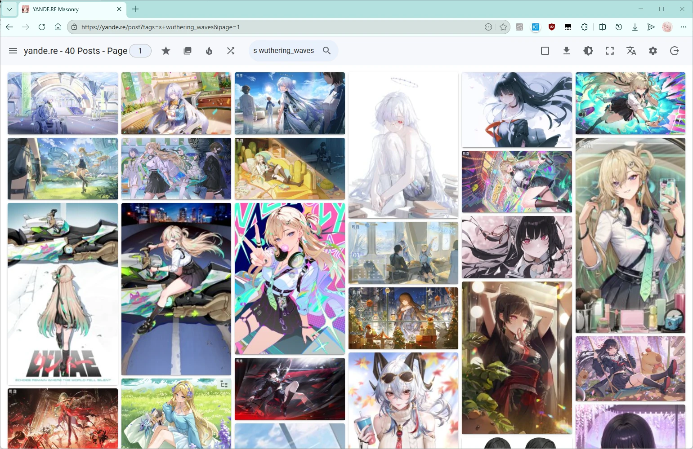
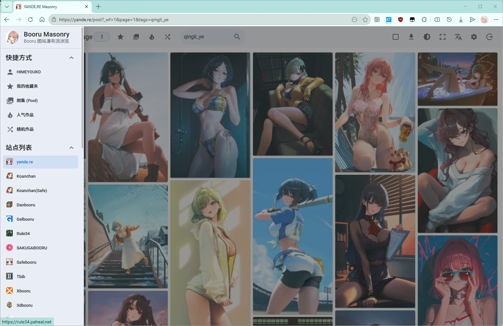
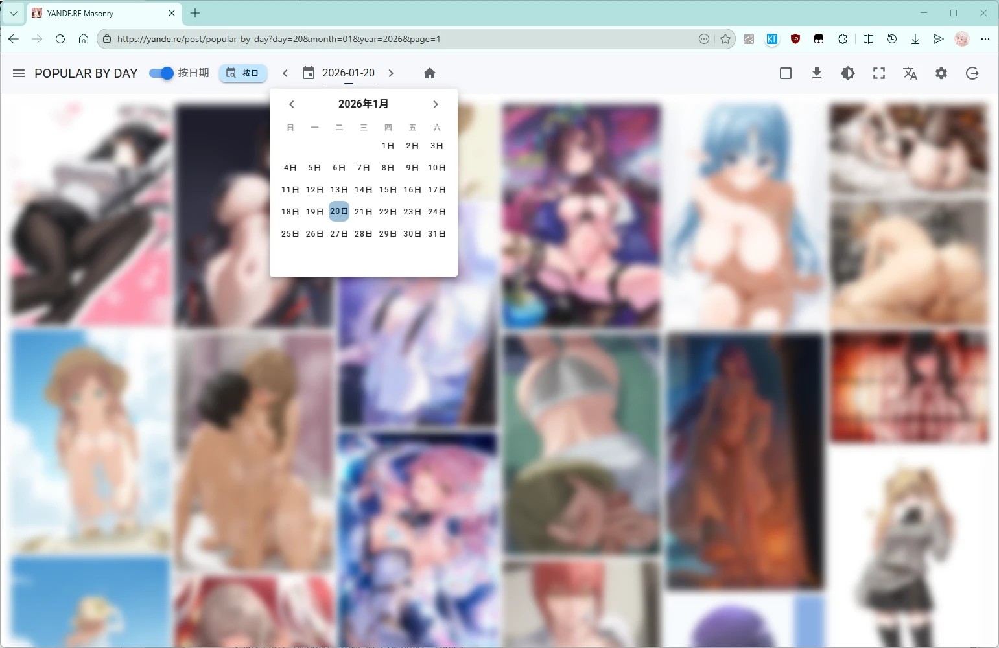
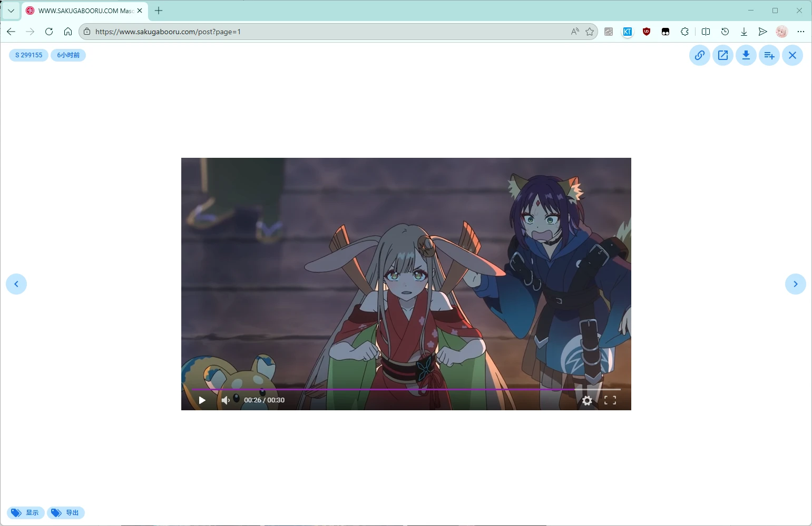
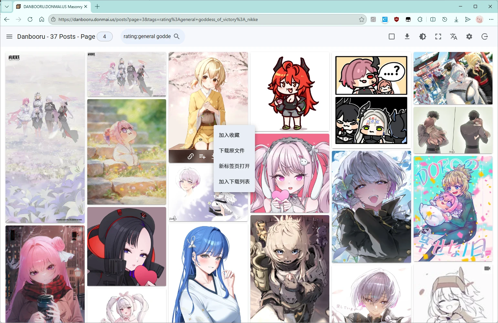
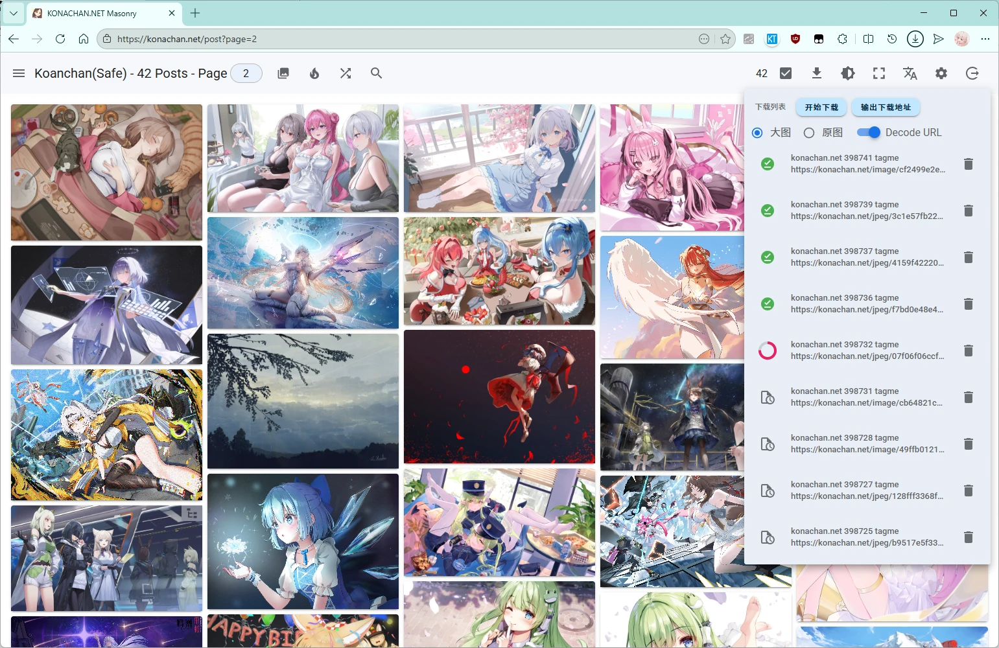
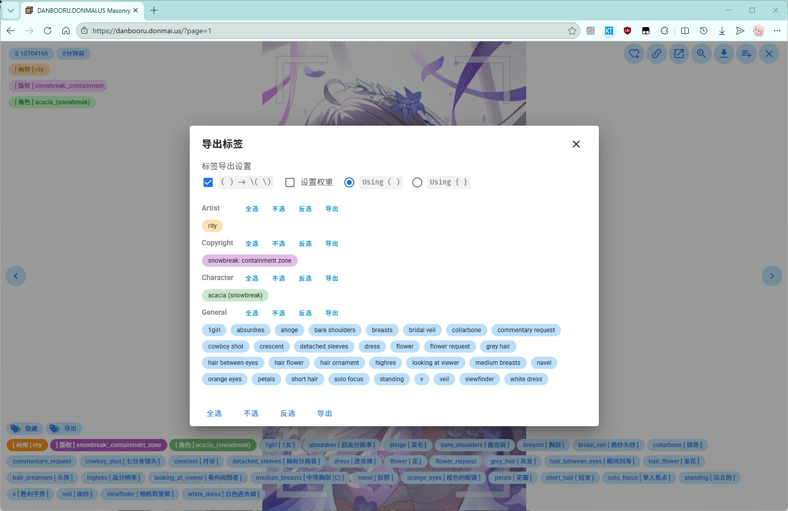

# Yande.re Masonry


[](https://github.com/asadahimeka/yandere-masonry/blob/main/CHANGELOG.md)


中文 | [简要](https://github.com/asadahimeka/yandere-masonry/blob/main/docs/README.old.md) | [English](https://github.com/asadahimeka/yandere-masonry/blob/main/README.en.md)

Yande.re/Konachan 中文标签 & 缩略图放大 & 双击翻页 & 瀑布流浏览

## 目录

- [项目简介](#-项目简介)
- [功能特性](#-功能特性)
- [支持站点](#-支持站点)
- [截图展示](#-截图展示)
- [安装指南](#-安装指南)
- [使用指南](#-使用指南)
- [常见问题](#-常见问题)
- [技术相关](#-技术相关)
- [开发指南](#-开发指南)
- [更新日志](#-更新日志)
- [贡献指南](#-贡献指南)
- [致谢](#-致谢)
- [许可证](#-许可证)
- [赞助](#-赞助)
- [统计](#-统计)

## 📖 项目简介

**Yande.re Masonry** 是一款专为二次元图片浏览网站打造的用户脚本（Userscript），旨在大幅提升浏览体验。它为 Yande.re、Konachan 及超过 20 个 Booru 站点带来了瀑布流布局、中文标签翻译、缩略图放大、双击翻页等实用功能。

本项目最初基于 [zhzwz/yande-re-chinese-patch](https://github.com/zhzwz/yande-re-chinese-patch) 改进而来，现已发展为功能完善的现代化用户脚本。

- 🎨 **沉浸式浏览** - 瀑布流布局让浏览更加流畅高效
- 🌏 **本地化支持** - 完整的中文标签翻译，消除语言障碍
- ⚡ **性能优化** - 虚拟滚动、懒加载等技术保证流畅体验
- 🔧 **高度可定制** - 丰富的设置选项满足不同用户需求
- 🌐 **多站支持** - 一次安装，支持 20+ 站点

---

## ✨ 功能特性

### 🖼️ 瀑布流浏览模式

核心功能，彻底改变浏览体验：

- **多种布局方式**：
  - Masonry（等宽不等高）- 经典瀑布流
  - Grid（等宽等高）- 规整网格
  - Justified（适高不等宽）- 紧凑布局
  - Virtual（虚拟滚动）- 大量图片时的最佳选择

- **智能加载**：
  - 滚动到底部自动加载更多
  - 支持无限滚动
  - 虚拟滚动优化性能

- **列数自定义**：
  - 自动模式（根据屏幕宽度）
  - 手动选择 1-20 列
  - 小于 7 列时自动切换到高清预览

### 🏷️ 标签中文翻译

消除英语标签的浏览障碍：

- **完整翻译覆盖**：
  - Yande.re/Konachan 标签翻译（来源：[yande-re-chinese-patch](https://github.com/zhzwz/yande-re-chinese-patch)）
  - Danbooru 系站点翻译（来源：[danbooru-diffusion-prompt-builder](https://github.com/wfjsw/danbooru-diffusion-prompt-builder)）
  - 其他站点标签（来源：[Yellow-Rush/zh_CN-Tags](https://github.com/Yellow-Rush/zh_CN-Tags)）

- **智能补全**：输入标签时实时提示和翻译

- **持续更新**：欢迎通过 PR 补充或校正翻译

### 🔍 搜索与筛选

强大的搜索功能（基于原站点搜索语法）：

- **标签搜索**：支持标签自动补全
- **高级搜索**：支持 rating（评分）、order（排序）等元标签
- **黑名单过滤**：本地标签黑名单，屏蔽不感兴趣的内容
- **NSFW 控制**：一键切换显示/隐藏 NSFW 内容

- **排序方式**：
  - 按分数、收藏数、分辨率
  - 按时间、热度
  - 随机、质量排序

### ➡️ 快捷浏览

提升浏览效率的细节功能：

非瀑布流模式下（Y 站/K 站）：

- **缩略图放大**：更大的预览图，一眼看细节
- **双击翻页**：双击左侧上一页，右侧下一页
- **访问标记**：已查看的图片下方显示横线

瀑布流模式：

- **键盘导航**：图片详情支持A/D/←/→键翻页
- **滚轮导航**：图片详情支持鼠标滚轮翻页
- **高清预览**：图片列表缩略图可使用高清图片链接
- **图片预加载**：图片详情支持预加载下一张样品图/原图
- **自动进入**：可设置自动进入瀑布流模式
- **图片铺满屏幕**：支持全宽显示模式，兼顾沉浸感与阅读留白

### 📥 批量下载

便捷的图片管理功能：

- **批量选择**：快速勾选多张图片
- **下载列表**：管理待下载的图片队列
- **导出链接**：导出图片地址为 TXT，支持迅雷/IDM/wget 等工具
- **文件名处理**：域名前缀 + 作品标签
- **下载来源选择**：原始文件（fileUrl）/ JPG 压缩图（jpegUrl）

### ⭐ 收藏与互动（Y 站/K 站）

- **一键收藏**：快速收藏到个人收藏夹
- **图集浏览**（Pool）：浏览相关作品合集
- **人气榜单**：查看热门、排名、近期收藏等

### 🎛️ 界面定制

- **深色模式**：护眼的夜间浏览体验
- **全屏模式**：沉浸式浏览，无干扰
- **列数切换**：根据喜好调整显示密度
- **图片分辨率显示**：直观了解图片尺寸
- **类型标识**：GIF、视频、子图、父图等图标标识

---

## 🌐 支持站点

### 完整支持（标签翻译 + 双击翻页 + 瀑布流）

| 站点 | 地址 | 特性 |
|------|------|------|
| Yande.re | https://yande.re | 完整支持，主要测试站点 |
| Konachan | https://konachan.com | 完整支持 |
| Konachan(Safe) | https://konachan.net | 完整支持 |
| Sakugabooru | https://www.sakugabooru.com | 几乎完整支持 |

### 基本支持（瀑布流）

| 站点 | 地址 | 特性 |
|------|------|------|
| Danbooru | https://danbooru.donmai.us | 基本支持 |
| Gelbooru | https://gelbooru.com | 基本支持（需要 API Key） |
| Rule34 | https://rule34.xxx | 基本支持（需要 API Key） |
| Safebooru | https://safebooru.org | 基本支持 |
| AIBooru | https://aibooru.online | 基本支持 |
| Xbooru | https://xbooru.com | 基本支持 |
| ATFBooru | https://booru.allthefallen.moe | 基本支持 |
| TBIB | https://tbib.org | 基本支持 |
| Rule34 Paheal | https://rule34.paheal.net | 基本支持 |
| Lolibooru | https://lolibooru.moe | 基本支持（站点目前无法访问） |
| 3dbooru | http://behoimi.org | 基本支持（站点目前无法访问） |

### 有限支持（瀑布流、部分功能限制）

| 站点 | 地址 | 说明 |
|------|------|------|
| Anime Pictures | https://anime-pictures.net | 部分功能限制 |
| Anihone Wallpaper | https://anihonetwallpaper.com | 部分功能限制 |
| All Girl | https://allgirl.booru.org | 部分功能限制 |
| e-shuushuu | https://e-shuushuu.net | 部分功能限制 |
| Zerochan | https://www.zerochan.net | 部分功能限制 |
| Sankaku App | https://sankaku.app | 部分功能限制（不稳定） |
| Sankaku Complex | https://chan.sankakucomplex.com | 部分功能限制（不稳定） |
| Idol Complex | https://www.idolcomplex.com | 部分功能限制（不稳定） |
| Realbooru | https://realbooru.com | 部分功能限制 |
| Hentai Booru | https://booru.eu | 部分功能限制 |
| Kusowanka | https://kusowanka.com | 部分功能限制 |
| Nozomi.la | https://nozomi.la | 部分功能限制 |
| Rule34 Hentai | https://rule34hentai.net | 部分功能限制 |

> ⚠️ **注意**：
> - 主要支持的站点是 Yande.re 和 Konachan，其他站点为基本支持
> - 部分站点可能存在页面列表与 API 返回不一致的情况
> - 有些站点需要设置 API Key 后才能正常使用

### 自部署 Szurubooru 支持

支持任意自部署的 [szurubooru](https://github.com/rr-/szurubooru) 实例（列表/详情/下载/标签搜索）。内置演示站：[Nekomaru](https://nekomaru.moe)（侧边栏显示为 Szurubooru(Demo)），可直接体验。

**配置步骤**：

1. 在 [nekomaru.moe](https://nekomaru.moe/post?_wf=1)（或任一 szurubooru 站点）打开瀑布流，点击顶栏「Szurubooru 指引」按钮（或侧边栏 → 设置）打开设置面板
2. 在「Szurubooru 站点」中点击「添加 Szurubooru 站点」，填写你的自部署域名（如 `https://szuru.example.com`），支持配置多个站点；配置保存在脚本内，对所有站点生效，已配置的域名也会显示在侧边栏站点列表中
3. 私有实例：登录站点 → 右上角用户菜单 → 登录令牌（Login tokens）创建令牌，在该站点配置中填入用户名与令牌；公开实例留空即可
4. 在 Tampermonkey 中为脚本添加自部署域名的匹配：管理面板 → 本脚本 → 设置 → 包含/用户域名，添加 `https://szuru.example.com/*`（此步骤必须，否则脚本不会注入到你的站点）
5. 打开自部署站点的 `/posts` 页即可使用

> 💡 「Szurubooru 站点」设置组仅在 szurubooru 站点（demo 站或已配置域名的站点）显示。

---

## 📸 截图展示




















---

## 🚀 安装指南

> ⚠️ **兼容性相关**：
> - 主要测试环境是 Windows + Chrome/Edge 浏览器
> - Firefox 浏览器尽力支持
> - Safari 浏览器支持有限

### 方法一：通过 Greasy Fork 安装（推荐）

1. **安装用户脚本管理器**（如果尚未安装）：
   - Chrome/Edge: [Tampermonkey](https://www.tampermonkey.net/) 或 [Violentmonkey](https://violentmonkey.github.io/)
   - Firefox: [Tampermonkey](https://www.tampermonkey.net/) 或 [Greasemonkey](https://www.greasespot.net/)
   - Safari: [Userscripts](https://apps.apple.com/app/userscripts/id1463298887) 或 [Stay for Safari](https://apps.apple.com/app/stay-for-safari/id1591620171)

2. **安装脚本**：
   - 点击 Greasy Fork: [点击安装](https://greasyfork.org/zh-CN/scripts/444885)
   - 或 Sleazy Fork: [点击安装](https://sleazyfork.org/scripts/444885)
   - 在弹出的确认页面点击"安装"

3. **验证安装**：
   - 访问任意支持的站点（如 yande.re）
   - 页面右上角应出现"进入瀑布流"按钮

### 方法二：从 GitHub 直接安装

1. 下载脚本文件：
   - [点击下载](https://github.com/asadahimeka/yandere-masonry/raw/main/dist/yandere-masonry.user.js)
2. 打开用户脚本管理器
3. 点击"新建脚本"或拖入文件安装

### 方法三：Web 版本试用

无需安装，直接在浏览器中体验：
- [在线预览版本](https://booru.vercel.app/)

### 更新脚本

脚本会自动检查更新，或手动更新：
- 在 Tampermonkey 管理面板点击"检查更新"
- 或重新安装最新版本

---

## 📖 使用指南

### 快速开始

1. 访问任意支持的站点（如 yande.re/post）
2. 点击右上角"进入瀑布流"按钮
3. 享受全新的浏览体验！

### 瀑布流模式操作

#### 顶部工具栏

| 图标 | 功能 |
|------|------|
| ⚙️ | 打开设置 |
| 1️⃣ | 页码切换 |
| ⭐ | 浏览我的收藏 |
| 🔥 | 浏览人气作品 |
| 🔀 | 随机浏览 |
| 🔍 | 标签搜索 |
| ☑️ | 批量选择 |
| ⬇️ | 下载管理 |
| ☀️ | 深色模式切换 |
| ⛶ | 全屏模式 |
| 🌐 | 语言切换 |
| ⏏️ | 退出瀑布流 |

#### 侧边栏

- **站点切换**：在不同站点间快速切换
- **黑名单管理**：添加不想看到的标签
- **API 凭证**：设置需要登录站点的凭证
- **NSFW 控制**：显示/隐藏敏感内容
- **布局模式**：Masonry/Grid/Justified/Virtual
- **列数设置**：自动或 1-20 列
- **键盘滚轮**：控制详情图片切换
- **图片预加载**：控制详情图片预加载与数量
- **缩略大图**：控制列表图片缩略图使用大图链接
- **容器定宽**：控制图片列表两侧是否留白
- **自动进入**：控制是否自动进入瀑布流模式
- **信息展示**：控制图片列表是否展示图片分辨率
- **按钮位置**：控制图片详情里操作按钮栏的位置
- **关闭行为**：控制图片详情里关闭弹窗的触发行为
- **查看工具**：可使用 Fancybox 插件来查看图片详情

#### 图片操作

列表：

- **单击**：打开图片详情
- **右键**：快捷菜单（收藏、下载、打开详情等）
- **中键**：鼠标中键点击详情链接按钮在新标签页打开

详情：

- 详情链接
- 来源地址
- 画师链接
- 标签链接
- 标签展示
- 标签导出
- 收藏作品
- 放大图片
- 下载作品

#### 快捷键

| 按键 | 功能 |
|------|------|
| <kbd>←</kbd> / <kbd>→</kbd>| 上一张/下一张图片 |
| <kbd>A</kbd> / <kbd>D</kbd> | 上一张/下一张图片 |
| <kbd>Enter</kbd> | 搜索标签 |
| 鼠标滚轮 | 上一张/下一张图片 |
| 鼠标中键 | 新标签页打开链接 |

### 标签搜索

1. 点击 🔍 搜索按钮
2. 输入标签（仅支持英文）
3. 实时显示补全建议
4. 按回车执行搜索

### 批量下载

1. 勾选想要下载的图片
2. 点击 ⬇️ 下载按钮
3. 选择：
   - 直接下载：使用浏览器下载管理器
   - 导出链接：保存为 TXT 文件，用其他工具下载
4. 配置选下载源（Y 站/ K 站）：原图/JPG 压缩图

### 收藏功能

支持以下站点：

- yande.re
- konachan.com
- konachan.net
- danbooru.donmai.us
- gelbooru.com
- rule34.xxx

---

## ❓ 常见问题

### Q: 为什么有些站点功能不完整？

A: 项目主要针对 Yande.re 和 Konachan 优化，其他站点为基本支持。部分站点 API 限制或结构差异导致功能受限。

### Q: 瀑布流模式下的图片与原站列表不一致？

A: 瀑布流使用站点 API 获取数据，可能与页面渲染逻辑不同。这是正常现象。

### Q: 标签翻译不完整怎么办？

A: 欢迎通过 PR 补充翻译！具体步骤见"贡献翻译"部分。

### Q: 如何禁用某个功能？

A: 在设置侧边栏中可以关闭大部分功能，如缩略图放大、NSFW 显示等。

### Q: 脚本是否支持移动端？

A: 部分支持。主要针对桌面端优化，移动端体验可能不完善。

### Q: 为什么有些站点无法使用？

A: 需要登录账号并设置 API 凭证。在侧边栏中设置凭据后即可。

### Q: 下载功能很慢？

A: 浏览器下载有并发限制。建议使用"导出链接"功能，配合专业下载工具（如 IDM、wget、aria2 等等）。

### Q: 如何反馈问题或建议？

A: 请到 [GitHub Issues](https://github.com/asadahimeka/yandere-masonry/issues) 提交反馈。

---

## 🎯 技术相关

### 前端技术栈

- **Vue 2.7 + Composition API**：
  - 使用 Vue 2.7 Composition API 特性
  - `<script setup>` 语法，代码更简洁
  - 响应式状态管理，性能优秀

- **TypeScript 严格模式**：
  - 类型安全保障
  - 智能提示和自动补全
  - 减少运行时错误

- **Vite 构建工具**：
  - 极快的开发体验
  - HMR（热模块替换）
  - 生产构建优化

### 核心技术实现

- **瀑布流布局算法**：
  - 自适应列数计算
  - 最小化空隙
  - 支持多种布局策略

- **智能预加载**：
  - 预加载下一屏图片
  - 可配置预加载数量

- **虚拟滚动**：
  - 仅渲染可视区域元素
  - 支持大量图片流畅滚动
  - 内存占用低

### 多站点架构

- **统一 API 抽象**：
  - `@himeka/booru` 库提供大部分接口
  - 自动适配不同站点的 API 差异
  - 易于扩展新站点

- **动态站点检测**：
  - 自动识别当前站点
  - 加载对应的适配器
  - 智能处理特殊情况

---

## 💻 开发指南

### 技术栈

- **框架**: Vue 2.7 (Composition API)
- **语言**: TypeScript
- **构建**: Vite 2.9
- **UI 组件**: Vuetify 2
- **状态管理**: Vue.observable
- **布局**: vue-masonry-css, @lhlyu/vue-virtual-waterfall
- **国际化**: vue-i18n
- **工具库**: @vueuse/core, date-fns
- **API**: @himeka/booru

### 环境要求

- Node.js >= 16
- pnpm >= 9
- Git

### 开发步骤

```bash
# 1. 克隆仓库
git clone https://github.com/asadahimeka/yandere-masonry.git
cd yandere-masonry

# 2. 安装依赖
pnpm install

# 3. 启动开发服务器
pnpm run dev

# 4. 在浏览器中打开
# - 访问 http://127.0.0.1:3000/_development.user.js 安装开发脚本
# - 在支持的站点加载开发版本
```

### 可用命令

```bash
pnpm run dev          # 启动开发服务器
pnpm run build        # 构建生产版本
pnpm run release      # 发布流程（版本号管理）
pnpm run lint         # 代码检查
```

### 项目结构

```
yandere-masonry/
├── src/
│   ├── api/              # 各站点 API 适配器
│   │   ├── danbooru.ts   # Danbooru API
│   │   ├── moebooru.ts   # Y/K 站 API
│   │   ├── gelbooru.ts   # Gelbooru API
│   │   └── ...
│   ├── components/        # Vue 组件
│   │   ├── AppBar.vue     # 顶部工具栏
│   │   ├── PostList.vue   # 图片列表
│   │   ├── PostDetail.vue # 图片详情
│   │   └── ...
│   ├── store/            # 状态管理
│   │   ├── index.ts      # 主 store
│   │   └── actions/      # 状态操作
│   ├── utils/            # 工具函数
│   │   ├── index.ts      # 通用工具
│   │   └── i18n.ts       # 国际化配置
│   ├── data/             # 静态数据
│   │   └── tags_cn.json  # 中文翻译
│   ├── plugins/          # Vue 插件
│   │   ├── vuetify.ts       # Vuetify 配置
│   │   └── webfontloader.ts # 字体加载
│   ├── App.vue          # 根组件
│   ├── main.ts          # 入口文件
│   └── prepare.ts       # 脚本初始化
├── scripts/             # 构建脚本
│   ├── postbuild.mjs    # 后处理
│   └── release.mjs      # 发布流程
├── package.json
├── vite.config.ts       # Vite 配置
├── tsconfig.json        # TypeScript 配置
└── .eslintrc.json       # ESLint 配置
```

### 代码规范

- **格式化**：2 空格缩进，无分号，单引号
- **命名**：camelCase 变量/函数，PascalCase 组件，UPPER_SNAKE_CASE 常量
- **类型**：严格 TypeScript，明确的类型注解
- **组件**：使用 Composition API + `<script setup>`
- **导入**：使用 `@/` 别名引用本地模块

### 添加新站点支持

1. 在 `src/api/` 创建新的适配器文件
2. 实现站点特定的 API 调用
3. 注册站点
4. 测试功能是否正常
5. 提交 PR

### 贡献翻译

1. Fork 仓库
2. 编辑对应翻译文件：
   - Y/K 站：`src/data/tags_cn.json`
   - Danbooru：[danbooru_tags_json](https://github.com/asadahimeka/danbooru_tags_json)
3. 提交 PR

---

## 📝 更新日志

查看完整的版本历史和更新内容：
[CHANGELOG.md](https://github.com/asadahimeka/yandere-masonry/blob/main/CHANGELOG.md)

---

## 🤝 贡献指南

欢迎任何形式的贡献！

### 如何贡献

1. Fork 本仓库
2. 创建特性分支：`git checkout -b feature/AmazingFeature`
3. 提交更改：`git commit -m 'Add some AmazingFeature'`
4. 推送到分支：`git push origin feature/AmazingFeature`
5. 提交 Pull Request

### 贡献类型

- 🐛 Bug 修复
- ✨ 新功能
- 📝 文档改进
- 🎨 样式优化
- ⚡ 性能优化
- 🌍 国际化翻译
- ✅ 测试用例

---

## 🙏 致谢

本项目离不开以下开源项目：

- [zhzwz/yande-re-chinese-patch](https://github.com/zhzwz/yande-re-chinese-patch) - 基础项目
- [@himeka/booru](https://github.com/asadahimeka/booru) - 统一的 Booru API 库
- [AtoraSuunva/booru](https://github.com/AtoraSuunva/booru) - @himeka/booru 项目基础
- [vue-masonry-css](https://github.com/paulcollett/vue-masonry-css) - 瀑布流布局组件
- [@lhlyu/vue-virtual-waterfall](https://github.com/lhlyu/vue-virtual-waterfall) - 虚拟瀑布流组件
- [vite-plugin-tm-userscript](https://github.com/asadahimeka/vite-plugin-tm-userscript) - 用户脚本打包插件
- [Vuetify](https://vuetifyjs.com/) - UI 组件库
- [Vite](https://vite.dev/) - 打包工具

特别感谢：

- **TSUKYU** 的慷慨支持

---

## 📄 许可证

本项目采用 [MIT License](https://github.com/asadahimeka/yandere-masonry/blob/main/LICENSE) 开源。

Copyright © 2022 Yumine Sakura

---

## 💖 赞助

如果这个项目对你有帮助，欢迎请我[喝杯咖啡](https://sponsors-yumine.netlify.app)：

[](https://ko-fi.com/sakurayumine)

您的支持是我持续更新的动力！

---

## 📊 统计


<p></p>
